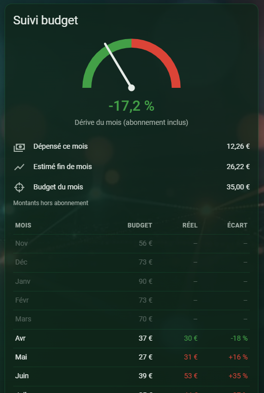
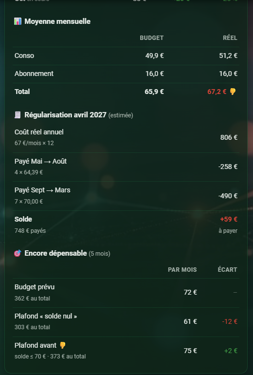

# Energy Budget Card

[](https://hacs.xyz)
[](https://github.com/microdav/energy-budget-card/actions/workflows/validate.yml)

A Home Assistant card to follow your electricity spending against a monthly budget, and, if you pay fixed monthly instalments, to see the year-end settlement coming.

*[Version française plus bas](#en-français).*

<p>
  
  
</p>

## Why

Most budget dashboards need a pile of helpers: utility meters, template sensors, an automation that saves last month's cost somewhere. This card needs **none of them**. It reads the long-term cost statistics that the **Energy dashboard** already keeps, so:

- the history survives restarts, reloads and integration outages;
- past months keep the price they were billed at (changing a tariff does not rewrite history);
- it works with any contract and any supplier: flat rate, peak/off-peak, Tempo, dynamic prices…

The only requirement is an Energy dashboard with a price on your grid consumption.

## Features

All blocks can be turned on or off.

| Block | What it shows |
|---|---|
| Drift gauge | Projected month-end bill compared with the month's budget |
| Current month | Spent so far, month-end estimate, month budget |
| Monthly table | Budget, actual and variance for each of the last 12 months |
| Monthly average | Average budget vs. average actual, subscription included |
| Settlement | Estimated annual cost minus what your instalments add up to |
| Still spendable | What you can still spend per month to end the year at zero, or within your accepted settlement |

**The consumption year can start in any month.** In France, for example, an EDF year runs from April to March. Months not lived yet in the current year count as exactly on budget. This way the settlement only reflects the gap built up so far.

## Installation

### HACS

1. HACS → ⋮ → *Custom repositories* → add `https://github.com/microdav/energy-budget-card`, category **Dashboard**.
2. Install **Energy Budget Card**, then reload the browser.

### Manual

Copy `dist/energy-budget-card.js` to `/config/www/`. Then add `/local/energy-budget-card.js` as a *JavaScript module* resource in *Settings → Dashboards → Resources*.

## Configuration

The card has a visual editor. Its **Suggest a budget** button fills the 12 months from your usage profile over the last 12 closed months. When instalments are set, the suggestion is scaled so that the year adds up to what you pay. Otherwise it reproduces last year's spending. You can then adjust each month by hand.

```yaml
type: custom:energy-budget-card
title: Budget
cycle_start_month: 4          # month zero: April → March
subscription: 16              # fixed monthly fee, not in the Energy statistics
budget:                       # usage only, subscription excluded
  1: 90
  2: 73
  3: 70
  4: 37
  5: 27
  6: 39
  7: 35
  8: 36
  9: 28
  10: 35
  11: 56
  12: 73
payments:
  start_month: 5              # first instalment
  tolerance: 70               # settlement you accept (👎 above it)
  installments:
    - amount: 64.39
      count: 4
    - amount: 70
      count: 7
```

| Option | Default | Description |
|---|---|---|
| `title` | localized | Card title (`""` hides it) |
| `cycle_start_month` | `1` | First month of the consumption year (1–12) |
| `subscription` | `0` | Monthly fixed fee |
| `budget` | – | Budget per month (1–12), usage only |
| `payments.installments` | – | List of `{amount, count}`. Leave it out for no settlement blocks |
| `payments.start_month` | month after `cycle_start_month` | Month of the first instalment |
| `payments.tolerance` | last instalment | Settlement above which the balance gets a 👎 |
| `payments.settlement_month` | `cycle_start_month` | Month shown in the settlement title |
| `show.gauge` … `show.remaining` | `true` | Show or hide each block: `gauge`, `summary`, `table`, `average`, `settlement`, `remaining` |
| `order` | `rolling` | `rolling` (last 12 months) or `cycle` (consumption year order) |
| `decimals` | `0` | Decimals for amounts |
| `threshold_pct` | `10` | Variance (%) from which a month is coloured |
| `gauge_range` | `50` | Gauge range (± %) |
| `gauge_name` | localized | Label under the gauge (`""` hides it) |
| `cost_statistics` | Energy dashboard | Your own list of cost statistics, used instead of the Energy dashboard |
| `exclude_statistics` | – | Energy dashboard cost statistics to ignore |
| `include_compensation` | `true` | Subtract grid export compensation |

**Every numeric value can also be an entity id**, for example `subscription: input_number.subscription` or `amount: input_number.instalment`. This lets you change it from the UI without editing the card.

### Cost source

By default the card adds up the cost of every **grid** source in the Energy dashboard. For each one it uses the cost statistic you set there, or the `_cost` sensor that Home Assistant creates when you enter a price. If you keep cost elsewhere, list it in `cost_statistics`. It must be a cumulative monetary sensor, such as a `total_increasing` sensor or an external statistic.

The current month estimate is a linear projection: spent so far ÷ elapsed time × days in the month.

## En français

Une carte pour suivre ta dépense d'électricité face à un budget mensuel et, si tu es mensualisé, anticiper la régularisation de fin d'année.

**Aucun helper, aucun template, aucune automatisation** : la carte lit directement les statistiques de coût long terme du **tableau de bord Énergie**. L'historique survit donc aux redémarrages. Les mois passés gardent le prix auquel ils ont été facturés. Et la carte marche avec tout contrat : Base, HP/HC, Tempo…

- **Mois zéro paramétrable** (`cycle_start_month`) : 4 pour une année EDF avril → mars.
- **Budget mois par mois**, saisi à la main. Le bouton **Proposer un budget** de l'éditeur le pré-remplit d'après ton profil de consommation réel des 12 derniers mois clos, mis à l'échelle de ce que tu paies.
- **Mensualisation en plusieurs tranches** (changement de mensualité en cours d'année), avec un seuil de régularisation acceptée (`tolerance`).
- **Chaque bloc s'affiche ou se masque** : jauge, mois en cours, tableau, moyenne, régularisation, encore dépensable.
- Toute valeur numérique peut être une entité (`input_number.…`).

Les options sont détaillées dans le tableau ci-dessus.

## License

MIT
